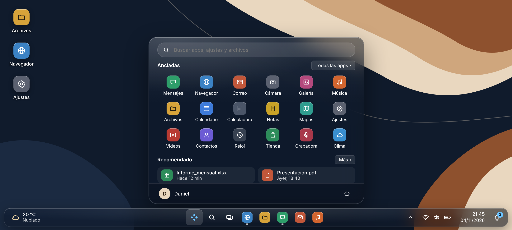
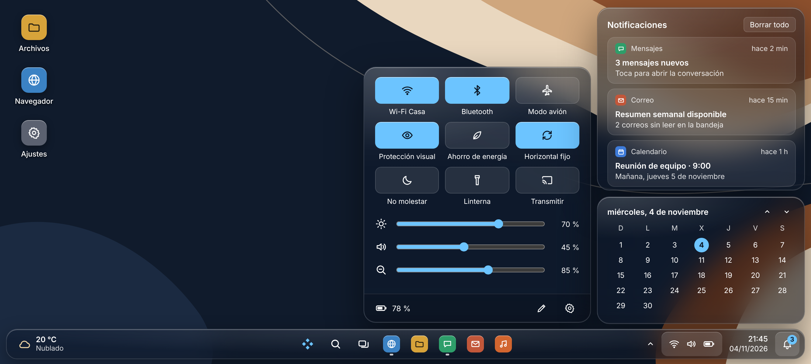

<div align="center">
  <h1>Escritorio Glass</h1>
  Un escritorio estilo PC para Android: barra de tareas, menú Inicio, ventanas y efecto vidrio.<br>
  Pensado para usar el celular en horizontal, con teclado y mouse.
</div>

> Escritorio Glass (`pe.vega.escritorioglass`) es un fork de [Smart Dock](https://github.com/axel358/smartdock),
> de Axel358, y se distribuye bajo la misma licencia [GPL-3.0](LICENSE). Todo el mérito del código original es
> de su autor y sus [colaboradores](Contributors.md). No está afiliado a Microsoft ni a Apple.



## Qué trae

- **Barra de tareas flotante de vidrio:** apps ancladas y abiertas; con Shizuku, un clic minimiza o restaura
  una ventana; wifi, volumen, batería, fecha y hora.
- **Menú Inicio:** búsqueda de apps, ancladas, recomendadas (las que usaste hace poco) y la lista completa;
  apagar, reiniciar o salir del modo escritorio.
- **Escritorio propio:** íconos pequeños que se abren con un clic; clic derecho o pulsación larga muestran
  su menú.
- **Ventanas:** las apps se abren en ventanas; selector de ventanas (Alt+Tab, el botón de vista de tareas o
  deslizar desde el borde inferior); Mostrar escritorio con Win+D o la esquina derecha de la barra.
- **Paneles:** ajustes rápidos, centro de notificaciones (responder y descartar) y calendario.
- **Escala del escritorio** para ver más contenido, todo en horizontal mientras el modo escritorio está activo,
  y atajos de teclado.



## Privacidad

- **Sin permiso de internet.** La compilación falla si alguna dependencia lo agrega: nada sale del celular.
- No lee el contenido de otras apps. Las teclas solo se usan como atajos y nunca se guardan.
- Las notificaciones solo se muestran y se descartan; no se guardan en ningún lado.
- Todo cambio del sistema (escala, rotación, cortina) se deshace al salir del modo escritorio.

## Requisitos

- Android 11 o superior. Probado en un POCO X7 Pro con HyperOS.
- Sin root. [Shizuku](#shizuku) y ADB son opcionales y suman funciones.

## Instalación

1. Descarga el APK desde [Versiones](https://github.com/erickmundaca0211-EM/escritorio-glass/releases) e
   instálalo.
2. Abre Escritorio Glass: una bienvenida te guía paso a paso por los permisos.
3. Si al activar la accesibilidad Android habla de una «configuración restringida» (pasa con los APK
   descargados): Ajustes > Apps > Escritorio Glass > ⋮ > «Permitir configuración restringida», y vuelve a
   intentarlo.

## Permisos

| Permiso | Para qué | |
|---|---|---|
| Mostrar sobre otras apps | Dibujar la barra, el menú Inicio y los paneles | Obligatorio |
| Accesibilidad (el modo escritorio) | Mostrar la barra, saber qué ventanas hay abiertas y responder a los atajos | Obligatorio |
| Acceso a notificaciones | El centro de notificaciones y el contador de la campana | Opcional |
| Uso de apps | Las recientes en Inicio y las apps abiertas sin Shizuku | Opcional |
| Calendario | El próximo evento junto a la fecha | Opcional |
| Shizuku | Minimizar, restaurar y cerrar ventanas; mantener cerrada la cortina del sistema | Opcional |
| Ajustes seguros (ADB) | La escala del escritorio y activar el modo escritorio desde la app | Opcional |

Para los ajustes seguros, con el celular conectado a una PC por USB:

```
adb shell pm grant pe.vega.escritorioglass android.permission.WRITE_SECURE_SETTINGS
```

La bienvenida se vuelve a abrir desde «Administrar permisos», en los ajustes de la app.

## Shizuku

[Shizuku](https://shizuku.rikka.app) es una app aparte, libre y de código abierto, que deja usar permisos de
ADB sin una PC. Instálala, iníciala con la depuración inalámbrica (se apaga cada vez que reinicias el celular)
y acepta el permiso para Escritorio Glass. Sin Shizuku el escritorio funciona con menos funciones.

## Si algo sale mal

- **La barra desapareció:** desactiva y vuelve a activar Escritorio Glass en Ajustes > Accesibilidad.
- **La pantalla quedó con otra escala:** en Ajustes > Pantalla vuelve al tamaño de siempre, o desde una PC:
  `adb shell wm density reset`.
- **Salir del modo escritorio:** menú Inicio > botón de apagado > «Salir del modo escritorio».

## Compilar

Hace falta el JDK 21 y el SDK de Android con la plataforma 36.

```
./gradlew assembleDebug
```

El APK queda en `app/build/outputs/apk/debug/`.

## Créditos y licencias

- [Smart Dock](https://github.com/axel358/smartdock), de Axel358 y sus [colaboradores](Contributors.md):
  GPL-3.0. Si te sirve, puedes [apoyar a Smart Dock](https://github.com/axel358/smartdock#support-the-project).
- [Shizuku API](https://github.com/RikkaApps/Shizuku-API), de RikkaApps: MIT.
- [RestrictionBypass](https://github.com/ChickenHook/RestrictionBypass), de ChickenHook: Apache 2.0.
- AndroidX y Material Components, de Google: Apache 2.0.
- La fuente [Inter](https://rsms.me/inter/): SIL Open Font License 1.1
  ([texto](app/src/main/assets/licenses/Inter-OFL.txt)).

Escritorio Glass se distribuye bajo la [Licencia Pública General GNU v3.0](LICENSE).
